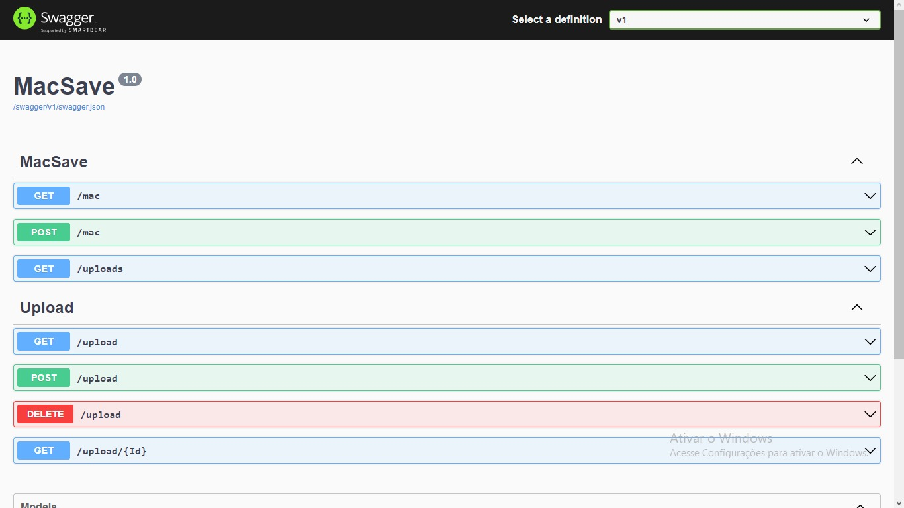

# MacRegister API

API para cadastro e consulta de dispositivos de rede, identificados por MAC e modelo. O front-end é o [webmacregister](https://github.com/matheusjean28/webmacregister).



<sub>A imagem é de uma versão anterior; as rotas atuais estão abaixo.</sub>

## Problema que resolve

Centraliza o inventário de equipamentos de rede, com fabricante e categoria, para consulta rápida pela equipe técnica.

## Funcionalidades

| Método | Rota | Ação |
| --- | --- | --- |
| GET | `/GetAllDevices` | Lista os dispositivos |
| GET | `/SearchDevices/{termo}` | Busca (mínimo de 5 caracteres) |
| POST | `/CreateNewDevice` | Cadastra um dispositivo |
| DELETE | `/DeleteDevice` | Remove um dispositivo |
| GET | `/GetAllMakers`, `/GetAllCategories` | Lista fabricantes e categorias |
| POST | `/CreateMaker`, `/CreateCategory` | Cria fabricante ou categoria |
| DELETE | `/DeleteCategory` | Remove uma categoria |

A busca sanitiza a entrada com expressões regulares.

## Tecnologias

C# · .NET 7 · ASP.NET Core · Entity Framework Core · SQLite · Swagger

## Como executar

Requer o SDK do .NET 7.

```bash
git clone https://github.com/matheusjean28/mac_register.git
cd mac_register
dotnet restore
dotnet run
```

O Swagger abre na raiz da aplicação. O perfil padrão usa `http://localhost:5242`.

## Estado e próximos passos

Versão pública inicial. A importação de CSV está desativada no código atual (`Controllers/UploadController.cs`).

- [ ] Reativar a importação de CSV
- [ ] Corrigir a busca, que hoje exige o termo no modelo **e** no MAC
- [ ] Adicionar autenticação
- [ ] Adicionar testes
- [ ] Remover os bancos `.db` do versionamento
